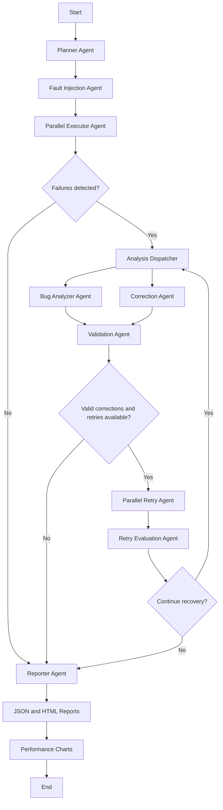

# AI API Testing Orchestrator

An AI-powered multi-agent REST API testing framework
built with Python, LangGraph, Model Context Protocol
(MCP), and Google Gemini.

The project demonstrates agentic AI, automated API
testing, parallel execution, controlled test recovery,
and automated reporting.

## Key Features

- AI-powered test case generation
- Multi-agent workflow orchestration
- Model Context Protocol integration
- Asynchronous REST API testing
- Parallel API request execution
- Parallel AI analysis agents
- Controlled fault injection
- AI-powered failure analysis
- AI-generated correction proposals
- Reference-based correction validation
- Autonomous retry loops
- Configurable maximum retry count
- Multiple AI model fallback
- Structured JSON logging
- Error classification
- Performance monitoring
- JSON and HTML test reports
- Embedded performance charts
- Portable API key configuration

## Technology Stack

| Technology | Purpose |
|---|---|
| Python | Main programming language |
| LangGraph | Multi-agent orchestration |
| LangChain Core | Agent execution callbacks |
| MCP / FastMCP | AI tool integration |
| Google Gemini | AI reasoning and test generation |
| HTTPX | Asynchronous REST API requests |
| AnyIO | Asynchronous MCP communication |
| Asyncio | Parallel task execution |
| Matplotlib | Performance visualization |
| Pytest | Regression testing |
| Python-dotenv | Environment configuration |
| JSONPlaceholder | Public demonstration REST API |

## Architecture



## Agent Responsibilities

| Agent | Responsibility |
|---|---|
| Planner | Generates REST API test cases |
| Fault Injection | Introduces a controlled incorrect expectation |
| Executor | Executes API tests through MCP |
| Analysis Dispatcher | Starts parallel analysis branches |
| Bug Analyzer | Analyzes failed test results |
| Correction | Proposes corrections to test expectations |
| Validation | Validates proposals against trusted reference data |
| Retry | Executes validated corrected tests |
| Retry Evaluation | Determines whether recovery should continue |
| Reporter | Produces the final test execution summary |

## Installation

### Prerequisites

- Python 3.13 recommended
- Git
- Google Gemini API key
- Internet connection

Development was performed using Python 3.13.18.

### Clone the Repository

Clone the repository using its GitHub URL,
then navigate to the project directory.

### Create a Virtual Environment

Linux or macOS:

```bash
python -m venv .venv
source .venv/bin/activate
```

Windows PowerShell:

```powershell
python -m venv .venv
.venv/Scripts/Activate.ps1
```

### Install Dependencies

```bash
pip install -r requirements.txt
```

### Configure the Gemini API Key

Copy .env.example to .env and set:

```ini
GOOGLE_API_KEY=your_api_key_here
```

Alternatively, configure GOOGLE_API_KEY as an
environment variable or a Google Colab Secret.

Never commit the real .env file or API key.

## Running the Application

```bash
python main.py
```

The application executes the multi-agent workflow
and generates test reports and performance charts.

## Generated Reports

Execution artifacts are stored in the reports directory.

- JSON test execution report
- HTML test execution report
- Visual HTML report with embedded charts
- Test result comparison chart
- Agent execution duration chart
- API request duration chart
- Test recovery chart

Structured execution logs are stored in:

```
logs/orchestrator.jsonl
```

Generated reports and logs are excluded from Git
by default.

## Project Structure

```
AI-API-Testing-Orchestrator/
    main.py
    config.py
    initialize.py
    orchestrator.py

    agents.py
    autonomous_agents.py
    parallel_autonomous_agents.py

    api_mcp_server.py
    api_specification.py

    workflow.py
    parallel_workflow.py
    parallel_branch_workflow.py
    parallel_executor.py

    logging_config.py
    agent_logging.py
    api_logging.py
    error_logging.py

    performance_metrics.py
    performance_visualization.py
    json_reporter.py
    html_reporter.py
    visual_reporter.py

    requirements.txt
    requirements-dev.txt
    .gitignore
    .env.example
    README.md

    docs/
    tests/
    examples/
```

## Performance Monitoring

The framework collects:

- Total workflow execution duration
- Individual agent execution durations
- API request durations
- Average, minimum and maximum durations
- Median and P95 durations
- Standard deviation
- Retry counts
- Test recovery statistics
- Error categories

## Security and Reliability

- API keys are managed outside the source code.
- Sensitive local files are excluded from Git.
- API paths are validated before execution.
- AI-generated corrections require reference validation.
- Retry loops have a configurable maximum limit.
- Parallel API execution has a concurrency limit.
- AI model fallback handles provider failures.
- Structured logs correlate events using execution IDs.

## Development Verification

The project has undergone incremental verification
covering agent orchestration, MCP communication,
parallel execution, retry handling, reporting,
and portable configuration.

One verified integrated execution produced:

| Metric | Result |
|---|---|
| Original test cases | 5 |
| Recovered test cases | 1 |
| Unresolved failures | 0 |
| Final pass rate | 100% |
| Generated reporting artifacts | 7 |
| Task 10 final verification checks | 58/58 |

These results describe a specific demonstration run
and do not guarantee identical results in future runs.

## Automated Regression Testing

The project includes 42 automated regression tests
implemented using Pytest.

### Install Development Dependencies

```bash
python -m pip install -r requirements-dev.txt
```

### Execute Regression Tests

```bash
python -m pytest tests -v
```

The regression tests use a dummy API key and do not
require live Gemini or REST API requests.

### Regression Test Coverage

| Test Category | Tests |
|---|---:|
| Core functionality | 18 |
| Agent and workflow functionality | 17 |
| Reporting and performance | 7 |
| Total | 42 |

### Verified Regression Results

| Metric | Result |
|---|---|
| Passed tests | 42 |
| Failed tests | 0 |
| Errors | 0 |
| Pass rate | 100% |
| Execution duration | 9.15 seconds |
| Exit code | 0 |

These results were obtained in the Google Colab
development environment using Python 3.13.18
and Pytest 8.4.2.

The regression suite covers:

- API path validation
- Error classification
- Test assertion evaluation
- Performance statistics
- Fault injection
- Conditional workflow routing
- Correction proposal validation
- Retry limits
- Concurrency parameter validation
- LangGraph workflow compilation
- JSON report generation
- HTML escaping
- Report persistence

Offline regression tests complement but do not
replace live end-to-end integration testing.

## Current Limitations

- Demonstration API coverage is limited to supported
  GET endpoints on JSONPlaceholder.
- AI-generated results may vary between executions.
- Internet access and a Gemini API key are required
  for normal live AI execution.
- Test correction is restricted to trusted reference
  expectations.
- The framework corrects controlled test expectation
  errors rather than repairing defects in the API.
- Cross-platform installation requires further
  verification.
- The project is an educational and professional
  portfolio demonstration, not a production-ready
  testing platform.

## Future Improvements

- OpenAPI specification import
- POST, PUT, PATCH and DELETE testing
- Authentication testing
- Database validation
- CI/CD integration
- Docker containerization
- Additional AI providers
- External MCP server integration
- Web-based execution dashboard

## Project Purpose

This project demonstrates the combination of
software quality assurance, REST API automation,
agentic AI, multi-agent orchestration, MCP,
asynchronous programming, and performance analysis.
