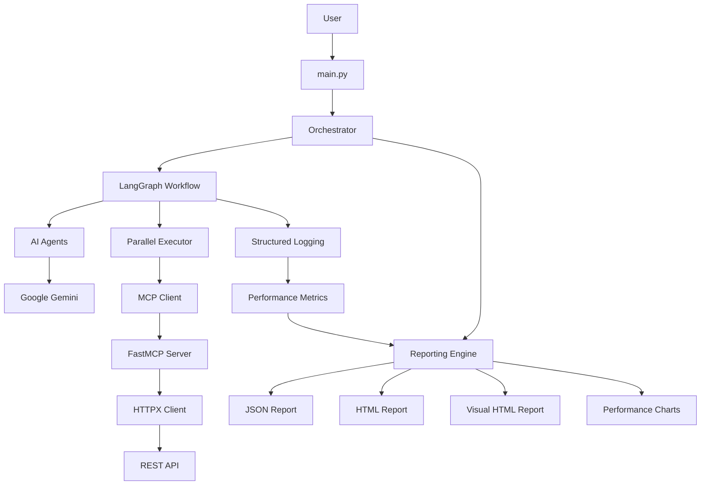
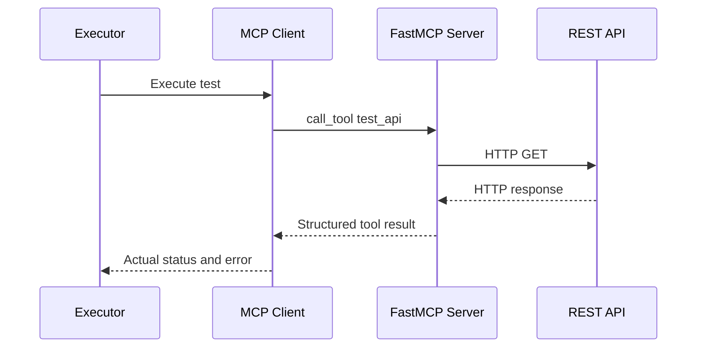

# System Architecture

## 1. Architecture Overview

The AI API Testing Orchestrator combines multi-agent
AI orchestration, MCP communication, asynchronous
API testing, controlled recovery and reporting.

## 2. Application Layer

Components:

- main.py
- orchestrator.py
- config.py
- initialize.py

Responsibilities:

- Application startup
- Configuration management
- Workflow execution
- Execution identification
- Timeout management
- Report generation

## 3. Agent Layer

Components:

- agents.py
- autonomous_agents.py
- parallel_autonomous_agents.py

Responsibilities:

- Test planning
- Controlled fault injection
- Failure analysis
- Correction proposals
- Reference-based validation
- Autonomous retry management
- Final test reporting

## 4. Workflow Layer

Components:

- workflow.py
- parallel_workflow.py
- parallel_branch_workflow.py

LangGraph manages agent execution, shared state,
conditional routing, parallel branches and retry loops.

The integrated orchestrator uses the parallel branch
workflow.

## 5. MCP Communication Layer

Components:

- api_mcp_server.py
- api_specification.py
- parallel_executor.py

The integrated workflow uses AnyIO memory streams
for in-process MCP communication.

The FastMCP server also provides a standalone
stdio entry point.

## 6. AI Provider Layer

Google Gemini provides:

- Test case generation
- Failure analysis
- Correction proposals

The application attempts configured models in order
and provides fallback behavior when AI requests fail.

## 7. Parallel Execution

Two levels of concurrency are implemented:

1. Parallel REST API test execution using asyncio.
2. Parallel AI analysis branches using LangGraph.

API request concurrency is limited using a semaphore.

The bug analyzer and correction agent execute in
parallel before the validation agent starts.

## 8. Logging and Observability

Components:

- logging_config.py
- agent_logging.py
- api_logging.py
- error_logging.py

Structured logs include execution identifiers,
agent events, API results, durations and error
categories.

## 9. Reporting Layer

Components:

- performance_metrics.py
- performance_visualization.py
- json_reporter.py
- html_reporter.py
- visual_reporter.py

The reporting layer produces:

- JSON execution reports
- HTML execution reports
- Visual HTML reports
- Four performance charts

## 10. Security Boundaries

- API keys are loaded from external configuration.
- API requests are restricted to supported paths.
- Correction proposals require trusted reference data.
- Retry attempts and API concurrency are limited.
- Generated logs and reports are excluded from Git.

## 11. Architecture Limitations

The project demonstrates a controlled testing
environment using JSONPlaceholder.

It does not repair application source code or
automatically resolve actual API defects.

The recovery mechanism corrects invalid test
expectations when trusted reference data supports
the correction.

Production deployment, comprehensive secret
redaction and independent concurrent workflow
isolation require further verification.
