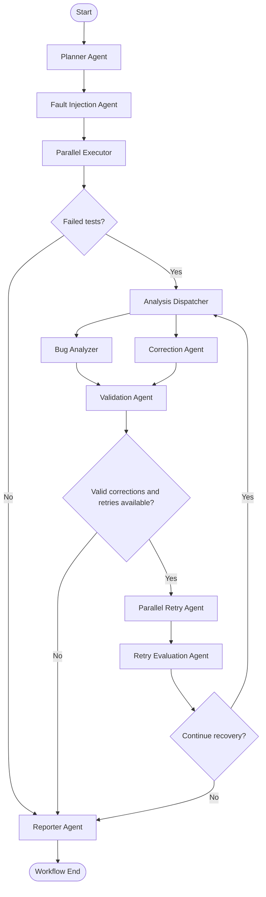
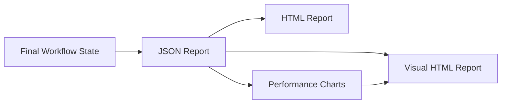

# Agent Workflow

## 1. Workflow Overview

The application executes a state-based LangGraph
workflow with conditional routing, parallel agents
and controlled autonomous retry loops.

## 2. Workflow Diagram

## 3. Agent Execution Sequence

| Step | Agent | Responsibility |
|---|---|---|
| 1 | Planner | Generate API test cases |
| 2 | Fault Injection | Introduce an incorrect expectation |
| 3 | Parallel Executor | Execute tests through MCP |
| 4 | Analysis Dispatcher | Start parallel analysis |
| 5 | Bug Analyzer | Analyze failures |
| 6 | Correction | Propose corrected expectations |
| 7 | Validation | Validate correction proposals |
| 8 | Parallel Retry | Execute corrected tests |
| 9 | Retry Evaluation | Decide whether to continue |
| 10 | Reporter | Summarize final test results |

The analysis agents execute concurrently rather
than sequentially.

## 4. Shared Workflow State

The AutonomousTestState contains:

| State field | Purpose |
|---|---|
| test_cases | Generated API tests |
| results | Original execution results |
| report | Final textual report |
| bug_analysis | AI-generated failure analysis |
| correction_proposals | Proposed corrections |
| validated_corrections | Accepted corrections |
| retry_results | Latest retry results |
| retry_count | Executed retry attempts |
| max_retries | Maximum retry attempts |
| retry_history | Previous retry executions |
| stop_reason | Workflow termination explanation |

## 5. Conditional Routing

After original execution:

- Failed tests trigger parallel analysis.
- Successful tests proceed to reporting.

After validation:

- Valid corrections and remaining retry capacity
  trigger another execution.
- Otherwise, the workflow proceeds to reporting.

After retry evaluation:

- Remaining retryable failures may trigger analysis.
- Successful retries or exhausted retry capacity
  terminate the recovery loop.

## 6. Autonomous Recovery Example

Original test:

    GET /posts/1
    Expected status: 404
    Actual status: 200

The AI correction agent proposes expected status 200.

The validation agent checks the proposal against
trusted reference expectations.

If accepted, the retry agent executes the test again.

    GET /posts/1
    Expected status: 200
    Actual status: 200

The test is classified as recovered.

This demonstrates correction of an intentionally
incorrect test expectation, not repair of an API bug.

## 7. Retry Safety

Recovery is controlled by:

- Maximum retry count
- Trusted reference expectations
- Correction validation
- Rejection of unsupported corrections
- Rejection of unchanged expectations
- Conditional workflow termination

The default maximum retry count is three.

## 8. Error Handling

The system provides:

- AI model fallback
- API execution error handling
- Error classification
- Workflow timeout handling
- Reporting failure handling
- Structured error logging

## 9. Reporting After Workflow Completion

The orchestrator generates reports after the
LangGraph workflow has completed.

## 10. Execution Status

PASSED means all final test expectations are satisfied.

FAILED means unresolved test failures remain.

NO_TESTS means no final test results are available.

A successful recovery does not prove that the
underlying API is defect-free.
